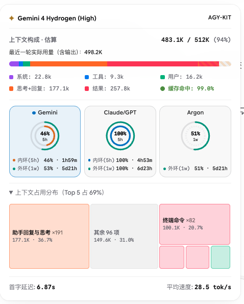
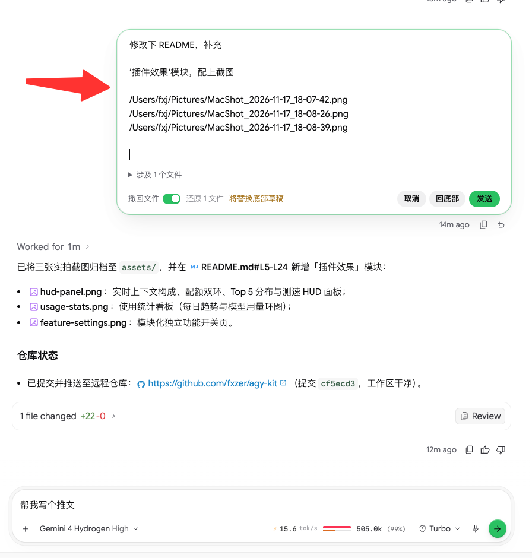
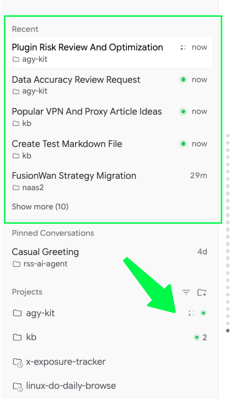
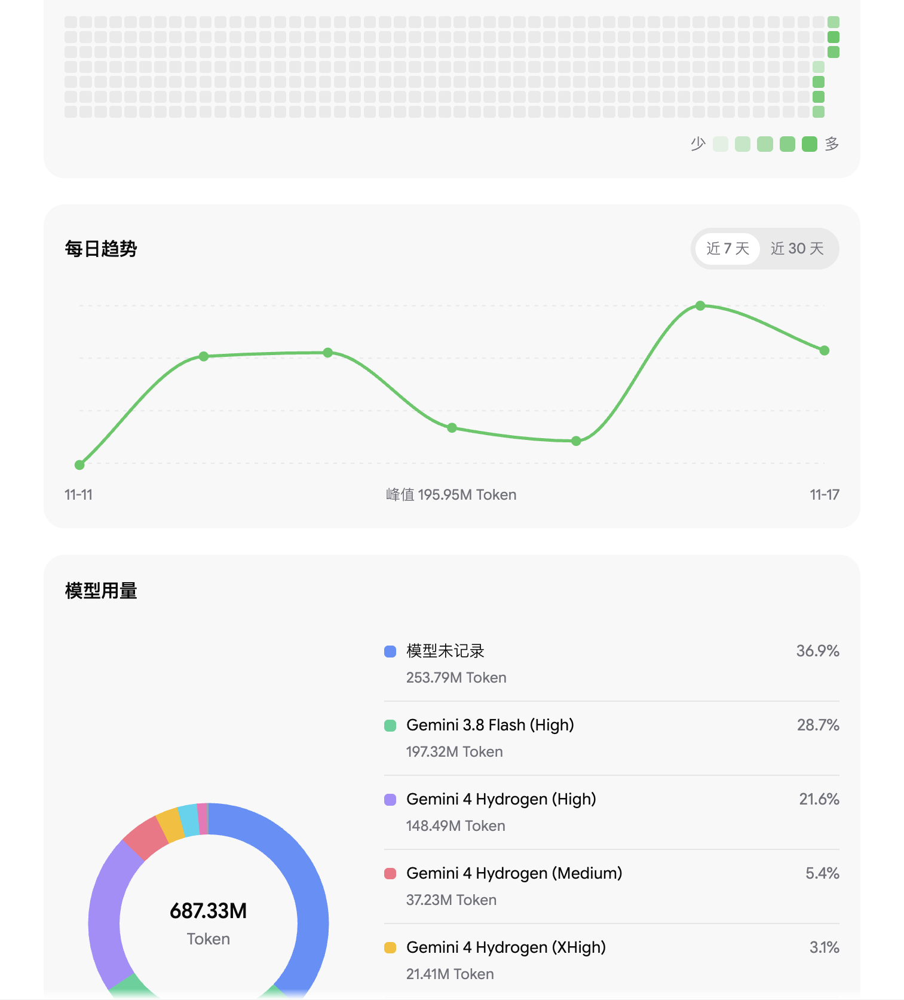
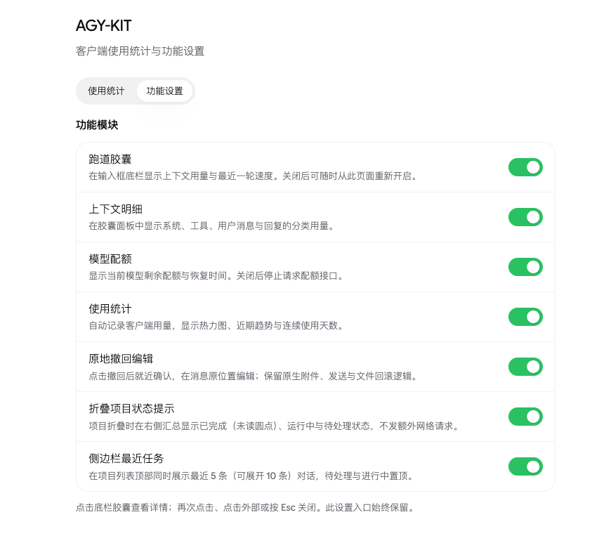

# agy-kit

Google Antigravity 2.x（macOS 桌面端）零依赖原生增强套件，集成了实时上下文/配额监控、使用统计看板、侧边栏效率增强与原地撤回编辑。

## 插件效果

### 实时监控与原地撤回编辑

<table>
  <tr>
    <td width="46%" align="center">
      <br>
      <sub>实时 HUD：上下文构成、双环配额、Top 5 分布与测速</sub>
    </td>
    <td width="54%" align="center">
      <br>
      <sub>原地撤回编辑框与底栏双轨胶囊（跟随系统主题色）</sub>
    </td>
  </tr>
</table>

### 侧边栏增强（最近任务 & 折叠项目角标）



### 使用统计与功能设置

<table>
  <tr>
    <td width="50%" align="center">
      <br>
      <sub>每日趋势与模型用量环图（随客户端主题色同步）</sub>
    </td>
    <td width="50%" align="center">
      <br>
      <sub>模块化独立开关（原生风格自适应主题）</sub>
    </td>
  </tr>
</table>

## 核心功能

- **底部双轨胶囊与实时 HUD**
  - 在输入框底栏原生嵌入实时生成速率（`tok/s`）、上下文占用条与模型配额条（`≤ 50%` 变橙、`≤ 20%` 变红预警）。
  - 点击胶囊展开 HUD 面板：展示五色上下文构成、Prompt 缓存命中率、多配额池（5h / 周限额）同心双环、Top 5 上下文占用分布（Treemap）以及首字延迟（TTFT）与平均速度。
  - 内置双阈值压缩检测（释放 `> 5,000` Tokens 且降幅 `>= 25%`）与自动退场，请求报错时保留上轮有效上下文。
- **客户端使用统计（Settings → AGY-KIT）**
  - 自动去重聚合本地客户端日志与实时采集用量，展示累计 Token、单日峰值、连续活跃天数、52 周热力图、7/30 天趋势曲线与模型占比环图。
- **侧边栏与编辑效率增强**
  - **最近任务（Recent）**：侧边栏顶部按「待处理 > 运行中 > 最近时间」快捷直达会话，支持 5/10 条切换与折叠。
  - **折叠项目角标**：在折叠项目文件夹上聚合显示待授权、运行中与已完成未读状态（跟随客户端系统主题色）。
  - **原地撤回编辑**：可选开启（默认关闭），在消息旁确认后原地展开重编并重发；完全复用客户端原生的撤回与文件还原能力（变更预览、保留/撤回文件开关与附件恢复），插件自身不执行任何文件读写或回滚逻辑。
- **模块化功能开关**
  - 所有核心模块均可在 `Settings → AGY-KIT → 功能设置` 独立开关并跨重启持久化保存。

## 环境要求

- macOS + [Antigravity](https://antigravity.google/) 桌面客户端（`/Applications/Antigravity.app`）
- Node.js 18+（零第三方依赖，无需 `npm install`）

## 安装与使用

### 1. 热挂载体验（免重启）

在 Antigravity 开启调试端口运行期间，直接热注入到当前窗口：

```bash
node cli.js live
# 或
npm run live
```

### 2. 持久安装与卸载（推荐日常使用）

操作前请先**完全退出 Antigravity**：

```bash
# 安装启动钩子、本地辅助服务并完成 macOS 重签名
node cli.js install   # 或 npm run install-kit

# 卸载并无损恢复安装前备份
node cli.js restore   # 或 npm run restore
```

### 3. 状态检查与测试

```bash
node cli.js status    # 查看宿主路径、调试端口与持久安装状态
npm test              # 运行单元测试
```

## 目录结构

```text
agy-kit/
├── cli.js                    # CLI 入口（live / install / restore / status）
├── package.json
├── assets/                   # README 效果展示截图
├── src/
│   ├── payload.js            # 底部胶囊、HUD 浮层与整体挂载调度
│   ├── telemetry.js          # RPC 遥测、配额解析与增量步骤采集
│   ├── session-insights.js   # 速度估算、双阈值压缩识别、Treemap 布局与异常分类
│   ├── reports-panel.js      # 使用统计看板（热力图 / 趋势图 / 模型环图）
│   ├── history-store.js      # 客户端历史用量扫描、去重与合并归档
│   ├── backend-service.js    # 本地 loopback 辅助服务（存储归档与配置）
│   ├── settings-panel.js     # Settings 入口与功能开关页
│   ├── settings-store.js     # 本地私有配置持久化
│   ├── inline-undo.js        # 原地撤回编辑与占位同步
│   ├── native-undo.js        # 原生撤回状态解析与回滚桥接
│   ├── folder-status.js      # 折叠项目状态聚合与角标渲染
│   ├── recent-section.js     # 侧边栏顶部「最近任务」区块
│   ├── persistence.js        # ASAR 持久注入、备份校验与 macOS 签名
│   ├── asar-engine.js        # 原生 Node.js ASAR 解包/封包引擎
│   └── startup-hook.js       # 主进程冷启动事件驱动注入
└── test/                     # 基于 node:test 的单元测试套件
```

## 账号安全与风控说明

`agy-kit` 仅在客户端本地展示与统计已有数据，**不涉及任何易触发平台风控的操作**：

- **不碰鉴权与凭据**：不读取、拦截或修改 OAuth 登录态、Token、系统 Keychain 与 Cookie。
- **不改协议与二进制**：不篡改对话请求参数（如上下文上限、模型参数），不修改客户端二进制文件。
- **节制调用、遇错熔断**：
  - 配额接口跨分屏共享缓存，常规最小间隔 **3 分钟**、手动刷新 **15 秒**冷却；报错即进入 **10 至 30 分钟**指数退避（可在「功能设置」中随时关闭）。
  - 对话轨迹仅读取本地语言服务器，**空闲时 0 轮询**，遇 `401 / 403 / 429` 立即熔断 **10 分钟**。
  - 侧边栏状态与最近任务纯读前端内存，**0 网络请求**。
- **支持免改盘运行**：不希望改动客户端 `app.asar` 与本地自签名时，可仅使用 `node cli.js live` 热挂载。

## 隐私与存储

- 本地辅助服务仅监听 `127.0.0.1` 随机端口，强制校验随机 Bearer Token 与本地客户端 `Origin`，不向任何外部第三方服务器联网。
- 归档与开关配置保存在 `~/.gemini/agy-kit/`（权限 `0600`），仅记录模型标识、时间戳与 Token 数值，不保存对话正文。
- 持久安装前自动创建带哈希校验的回滚备份，可随时通过 `node cli.js restore` 完整还原。

## License

MIT
